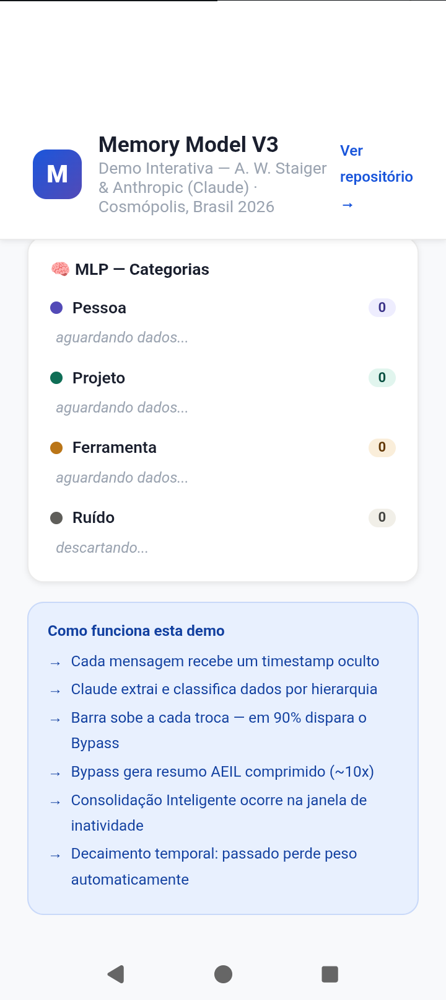
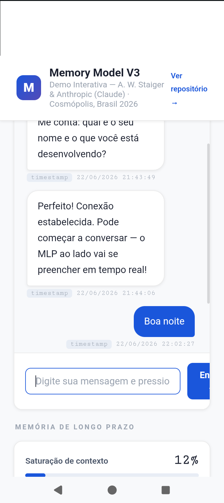

# Modelo de Memória — Arquitetura de Inteligência Comprimida

> Uma arquitetura de memória para assistentes de IA que guarda o essencial e sabe o que esquecer.

Desenvolvido por **Anthony William Staiger**, com apoio do Claude (Anthropic) · Cosmópolis, SP, Brasil · 2026

🎮 **[Demo interativa — sem chave de API](https://anthonystaiger8-bit.github.io/memory-model-demo/)**

---

## O problema

Assistentes de IA tratam tudo o que ouviram como igualmente importante. Informações de meses atrás pesam o mesmo que o momento presente, o contexto lota, os tokens acabam e a IA não percebe o tempo passar entre uma conversa e outra.

## A ideia: guardar chumbo, entregar algodão

Guardar internamente pouca informação, mas densa e comprimida (o **chumbo**), e entregar ao usuário uma conversa ampla e fluida (o **algodão**), que dura o mês inteiro sem acabar com a cota de tokens.

## Os pilares

- **Memória de Curto Prazo (MCP)** e **Memória de Longo Prazo (MLP)**: contexto da sessão separado dos fatos persistentes.
- **Timestamp por mensagem**: a IA percebe o tempo real que passou.
- **Consolidação por janela temporal**: a memória é organizada nos horários em que o usuário nunca usa o sistema.
- **Hierarquia de importância**: Pessoa > Projeto > Ferramenta > Ruído.
- **Bypass invisível**: ao saturar o contexto, uma nova sessão continua a anterior com um resumo denso.
- **AEIL**: linguagem interna compacta para a IA.

## Veja funcionando

## Documentação completa

Todos os detalhes (linha do tempo, sistemas, relógio em tempo real e protótipo) estão em [`docs/README-completo.md`](docs/README-completo.md).

## Autor

**Anthony William Staiger** · [GitHub](https://github.com/anthonystaiger8-bit) · [anthonystaiger8@gmail.com]

## Licença

CC BY-NC-ND 4.0 · Copyright (c) 2026 Anthony William Staiger

---

*"O melhor sistema de memória é aquele que sabe o que esquecer."* — A.W. Staiger, 2026
